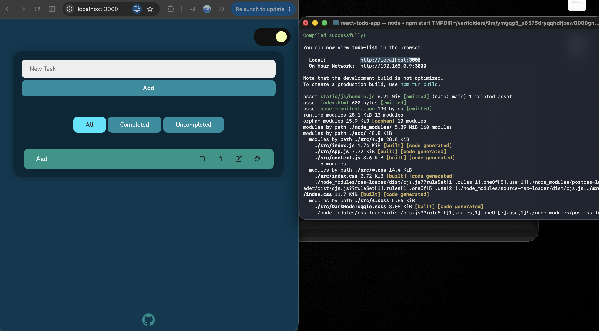
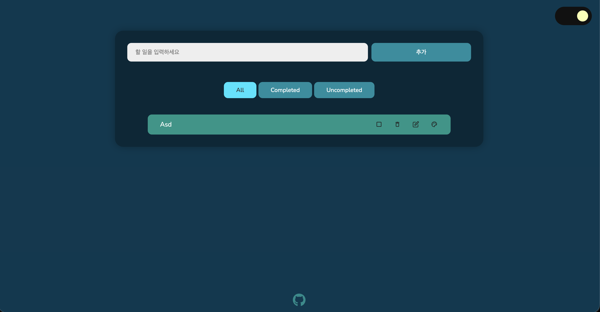
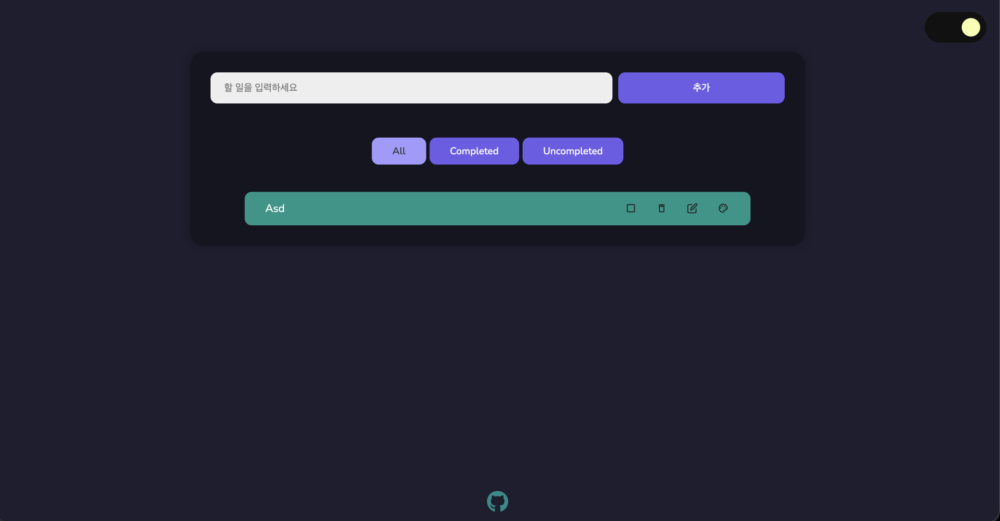
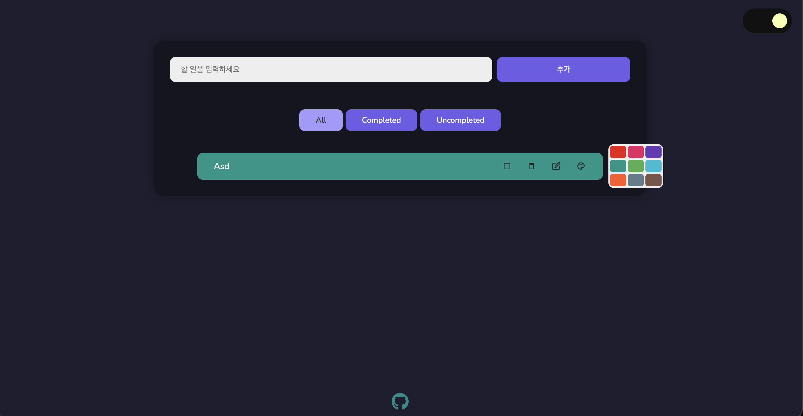
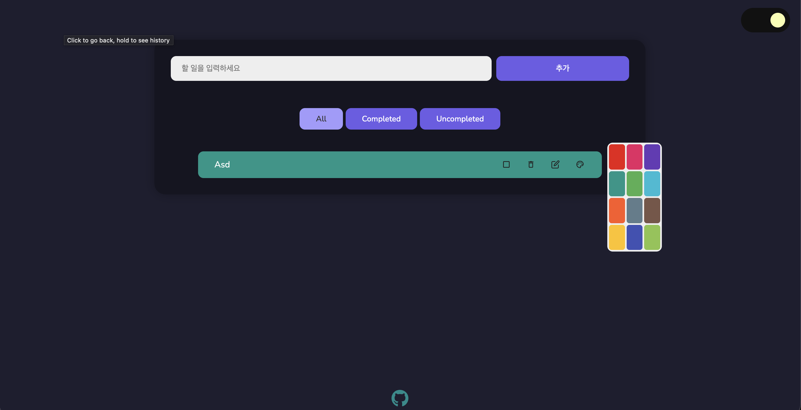

Project Information
1. React To-Do List
1. 원본 GitHub: https://github.com/ilyasbelaoud/react-todo-app
2. 라이선스: MIT License (Copyright (c) 2022 Ilyas Belaoud)

Installation

Source Code Exploration
1. index.js: AppProvider로 App을 감싸서 root에 그림.
2. context.js: tasks, filter 등과 삭제, 완료 체크, 수정 함수가 모여 있음. 다른 파일들에서 useGlobalContext()로 꺼내 씀.
3. App.js: 화면 전체 구성(입력창, 필터 버튼, 목록)과 할 일 추가 함수(addTask)가 있음.

선택 이유
1. 코드 소스가 (JS 파일) 많지 않아서 전체 흐름을 읽고 이해할 수 있는 규모임.
2. 직전 과제인 도서 관리 CRUD와 구조가 비슷함. 배열 데이터를 추가, 수정, 삭제하고 화면에 그리는 방식을 React state로 구현한 것이 어떻게 다른지 비교하기가 수월할 것 같았음.

주요 기능
1. 할 일 추가, 수정, 삭제, 완료 체크가 가능하고 All / Completed / Uncompleted 필터로 목록을 나눠 볼 수 있음.
2. tasks 배열이 바뀔 때마다 localStorage에 저장되어서 새로고침해도 데이터가 유지됨.
3. 항목별 색상 변경, 드래그로 순서 변경, 다크모드, 알림 메시지 기능.

ㅈ주요 컴포넌트
1. List: filter 값에 따라 tasks를 걸러서 Task를 반복해서 그림.
2. Task: 할 일 한 줄. 제목, 체크, 삭제, 수정, 색상 버튼이 들어 있음.

Customizing

1. Text : placeholder를 'New Task'에서 '할 일을 입력하세요'로, 버튼을 Add 에서 추가으로 바꿈.

2. Style: --bg-color, --primary-color, --secondary-color 값을 바꿔서 배경, 버튼 색이 바뀜.

3. UI/Data : 색상 팔레트에 색 3개를 추가해서 9개에서 12개가 됨.color-container의 height를 80px에서 200px로 바꿈.

4. 수정 후에도 추가, 수정, 삭제, 체크, 필터, 드래그, 다크모드가 정상 동작하는 것을 확인함.

어려웠던 점과 해결 방법
1. npm run dev를 쳤더니 실행이 안됐음. Missing script 오류가 났음. package.json의 scripts를 보니 npm start를 쓰는 프로젝트라서 명령어를 바꿔서 해결함.
